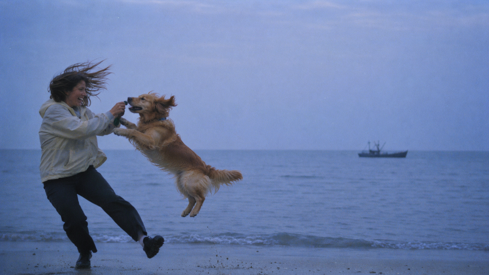

# MOSS Prompt Enhancer (GGUF)


A ComfyUI custom node that enhances ordinary image prompts into high-quality, detailed MOSS-Image prompts with proper layout and anatomical descriptions.

## Official MOSS enhancement and validation

This community node brings the prompt-enhancement workflow published by [OpenMOSS, the creators of MOSS-Image](https://github.com/OpenMOSS/MOSS-Image), into ComfyUI: enhance the description, create a caption or layout draft, then validate and compile it into a MOSS-ready prompt.

- **[Official prompt enhancement instructions (SKILL.md)](https://github.com/OpenMOSS/MOSS-Image/blob/main/skills/moss-image-prompt-enhancer/SKILL.md)** — Describes how agents should develop image descriptions, preserve the user's intent, and prepare caption or spatial-layout drafts. This node adapts those instructions for a local GGUF model.
- **[Official Python validator and compiler (compile_prompt.py)](https://github.com/OpenMOSS/MOSS-Image/blob/main/skills/moss-image-prompt-enhancer/scripts/compile_prompt.py)** — Checks the draft's fields, canvas dimensions, and bounding boxes, then converts the draft into the final MOSS prompt format. This node incorporates its compiler function.

Validation checks the generated structure and layout; it does not judge the description's creative quality or guarantee the resulting image.

## Features

- **Built-in MOSS enhancement**: Includes enhancement instructions adapted from the MOSS-Image prompt enhancer skill
- **Layout mode**: Generates structured layout JSON with bounding boxes for precise element placement
- **Caption mode**: Generates detailed natural language descriptions
- **Local GGUF inference**: Uses your local LLM models via llama.cpp (same as LLM Text Processor)
- **MOSS-ready output**: Validates and formats generated prompts using the official MOSS compiler
- **Automatic retry**: Retries invalid JSON with corrective feedback
- **GPU memory management**: Uses LLM Text Processor to release inference resources before image generation

## Installation

1. Clone or download this repository to your ComfyUI custom_nodes directory:
   ```
   <ComfyUI>/custom_nodes/ComfyUI-MOSS-Prompt-Enhancer
   ```

2. Ensure the following dependencies are installed:
   - numpy
   - Pillow
   - Python 3.10 or later

3. Install [ComfyUI LLM Text Processor by KingManiya](https://github.com/KingManiya/ComfyUI-LLM-text-processor) and follow its setup instructions. It is a required dependency for this node.

Image input requires a vision model with a matching `mmproj` file. Text-only use does not require a projector. Hardware and platform support depend on the installed LLM Text Processor. For offline use, ensure its llama.cpp backend is installed before disconnecting from the internet.

## Node Interface

### Required Inputs

| Parameter | Type | Description |
|-----------|------|-------------|
| `model` | GGUF dropdown | Local GGUF model from ComfyUI/models/LLM |
| `mmproj` | GGUF dropdown | Optional vision projector (required for image input) |
| `system_prompt` | Dropdown | Optional additional enhancement guidance |
| `prompt` | Text | Original image request to enhance |
| `max_tokens` | INT (8192) | Maximum generation tokens |
| `temperature` | FLOAT (0.3) | Sampling temperature |
| `top_p` | FLOAT (0.9) | Nucleus sampling threshold |
| `top_k` | INT (40) | Top-K sampling cutoff |
| `repeat_penalty` | FLOAT (1.05) | Repeated token penalty |
| `ctx_size` | INT (32768) | Context window size |
| `width` | INT (1024) | Canvas width in pixels |
| `height` | INT (1024) | Canvas height in pixels |
| `output_mode` | Dropdown | "Structured Layout" or "Caption" |
| `retry_invalid_json` | BOOLEAN (True) | Retry invalid JSON with error feedback |

### Optional Inputs

| Parameter | Type | Description |
|-----------|------|-------------|
| `image` | IMAGE | Optional image for vision models |
| `enable_processing` | BOOLEAN (True) | When false, passthrough original prompt |
| `extra_args` | STRING | Advanced llama.cpp parameters |

### Outputs

| Name | Type | Description |
|------|------|-------------|
| `RESPONSE` | STRING | Final compiled MOSS-Image ready prompt |
| `DRAFT_JSON` | STRING | Editable JSON draft generated by the LLM |
| `REASONING` | STRING | Extracted reasoning (if available) |
| `PERF` | STRING | llama.cpp performance metrics |
| `WIDTH` | INT | Actual canvas width |
| `HEIGHT` | INT | Actual canvas height |

## Usage

### Basic Workflow

1. Add the `MOSS Prompt Enhancer (GGUF)` node to your workflow
2. Select your local GGUF model
3. Enter your image request in the prompt field
4. Set canvas dimensions (width/height)
5. Connect the `RESPONSE` output to `MOSS Text Encode`
6. Connect the `WIDTH` and `HEIGHT` outputs to your latent generation node
7. Run the workflow

### Example

#### Original prompt

> beach, woman playing with dog, fisherboat in the distant, windy, blue hour, 35 mm photo

#### Structured JSON output

The editable `DRAFT_JSON` output describes the scene and places each subject using absolute pixel coordinates. This example uses a **1920 x 1088** canvas.

```json
{
  "width": 1920,
  "height": 1088,
  "bbox_coord_space": "abs",
  "bbox_format": "xyxy",
  "summary": {
    "caption": "A candid 35mm film photograph capturing a dynamic moment on a beach during the blue hour. In the foreground left, a woman in a light windbreaker laughs while interacting with a golden retriever that is leaping mid-air towards her. The wind is visibly strong, blowing their hair and the dog's fur to the right. The background features a calm ocean stretching to the horizon, where a small, dark silhouette of a fisherboat sits in the distance. The scene is bathed in cool blue ambient light with visible film grain.",
    "meta": [
      "35mm photography",
      "blue hour",
      "beach",
      "windy",
      "candid"
    ],
    "canvas": "single"
  },
  "items": [
    {
      "label": "character",
      "caption": "A woman with shoulder-length brown hair blown sharply to the right by the wind, wearing a light beige windbreaker and dark trousers. She is positioned on the wet sand in the left foreground, leaning slightly forward with her arms extended toward the dog, laughing with an open-mouthed expression. Her posture suggests active engagement, with one foot planted firmly and the other slightly lifted.",
      "bbox": [
        150,
        350,
        650,
        1050
      ]
    },
    {
      "label": "character",
      "caption": "A golden retriever captured mid-leap in the air, body angled upward and toward the woman. Its fur is ruffled by the wind, flowing to the right. The dog's front paws are extended forward as if reaching for a treat or toy held by the woman, while its hind legs are tucked slightly back. The expression is alert and playful.",
      "bbox": [
        450,
        400,
        950,
        850
      ]
    },
    {
      "label": "object",
      "caption": "A small, dark silhouette of a traditional fisherboat floating on the calm ocean surface in the far distance. It is positioned near the horizon line, appearing as a simple, elongated shape with a faint mast, barely distinguishable from the twilight water.",
      "bbox": [
        1400,
        580,
        1600,
        620
      ]
    }
  ]
}
```

#### Enhanced prompt (compiled output)

The `RESPONSE` output is the compiled MOSS-ready prompt. Connect it to MOSS Text Encode and use the same **1920 x 1088** canvas dimensions. The compiler converts the draft boxes into centered `yxyx` coordinates. The JSON below is formatted across multiple lines for readability; the node returns it as a single line.

```json
{
  "summary": {
    "caption": "A candid 35mm film photograph capturing a dynamic moment on a beach during the blue hour. In the foreground left, a woman in a light windbreaker laughs while interacting with a golden retriever that is leaping mid-air towards her. The wind is visibly strong, blowing their hair and the dog's fur to the right. The background features a calm ocean stretching to the horizon, where a small, dark silhouette of a fisherboat sits in the distance. The scene is bathed in cool blue ambient light with visible film grain.",
    "meta": [
      "35mm photography",
      "blue hour",
      "beach",
      "windy",
      "candid"
    ],
    "canvas": "single"
  },
  "items": [
    {
      "label": "character",
      "caption": "A woman with shoulder-length brown hair blown sharply to the right by the wind, wearing a light beige windbreaker and dark trousers. She is positioned on the wet sand in the left foreground, leaning slightly forward with her arms extended toward the dog, laughing with an open-mouthed expression. Her posture suggests active engagement, with one foot planted firmly and the other slightly lifted.",
      "bbox": [
        -194,
        -810,
        506,
        -310
      ]
    },
    {
      "label": "character",
      "caption": "A golden retriever captured mid-leap in the air, body angled upward and toward the woman. Its fur is ruffled by the wind, flowing to the right. The dog's front paws are extended forward as if reaching for a treat or toy held by the woman, while its hind legs are tucked slightly back. The expression is alert and playful.",
      "bbox": [
        -144,
        -510,
        306,
        -10
      ]
    },
    {
      "label": "object",
      "caption": "A small, dark silhouette of a traditional fisherboat floating on the calm ocean surface in the far distance. It is positioned near the horizon line, appearing as a simple, elongated shape with a faint mast, barely distinguishable from the twilight water.",
      "bbox": [
        36,
        440,
        76,
        640
      ]
    }
  ],
  "bbox_coord_space": "abs_centralized",
  "bbox_format": "yxyx"
}
```

#### Resulting image



## How It Works

1. The node takes your original image request
2. Uses MOSS-specific guidance to enhance it with your local GGUF model
3. Creates a detailed caption or structured layout
4. Checks the generated structure and requested canvas dimensions
5. Converts the result into the format expected by MOSS-Image
6. Returns the compiled, MOSS-Image-ready prompt

## Troubleshooting

### Node not appearing in ComfyUI
- Ensure the ComfyUI-LLM-text-processor is installed and working
- Check the ComfyUI console for import errors
- Verify Python dependencies (numpy, Pillow)

### JSON compilation errors
- Try increasing `max_tokens`
- Lower the `temperature` for more deterministic output
- Enable `retry_invalid_json` (default) for automatic correction

### Slow inference
- Use a smaller or quantized GGUF model
- Adjust `n_gpu_layers` for better GPU utilization
- Increase `timeout_seconds` if needed

## Credits

Thanks to **[KingManiya](https://github.com/KingManiya)** and the contributors to **[ComfyUI LLM Text Processor](https://github.com/KingManiya/ComfyUI-LLM-text-processor)**. This node depends on their project for local GGUF inference through llama.cpp, model and prompt discovery, optional image support, and inference process management.

Thanks to **[OpenMOSS](https://github.com/OpenMOSS/MOSS-Image)** for MOSS-Image and the official prompt enhancement instructions and validator/compiler linked above.

## License

This node uses the official MOSS-Image prompt compiler from the [OpenMOSS/MOSS-Image repository](https://github.com/OpenMOSS/MOSS-Image). See that repository for licensing details.
