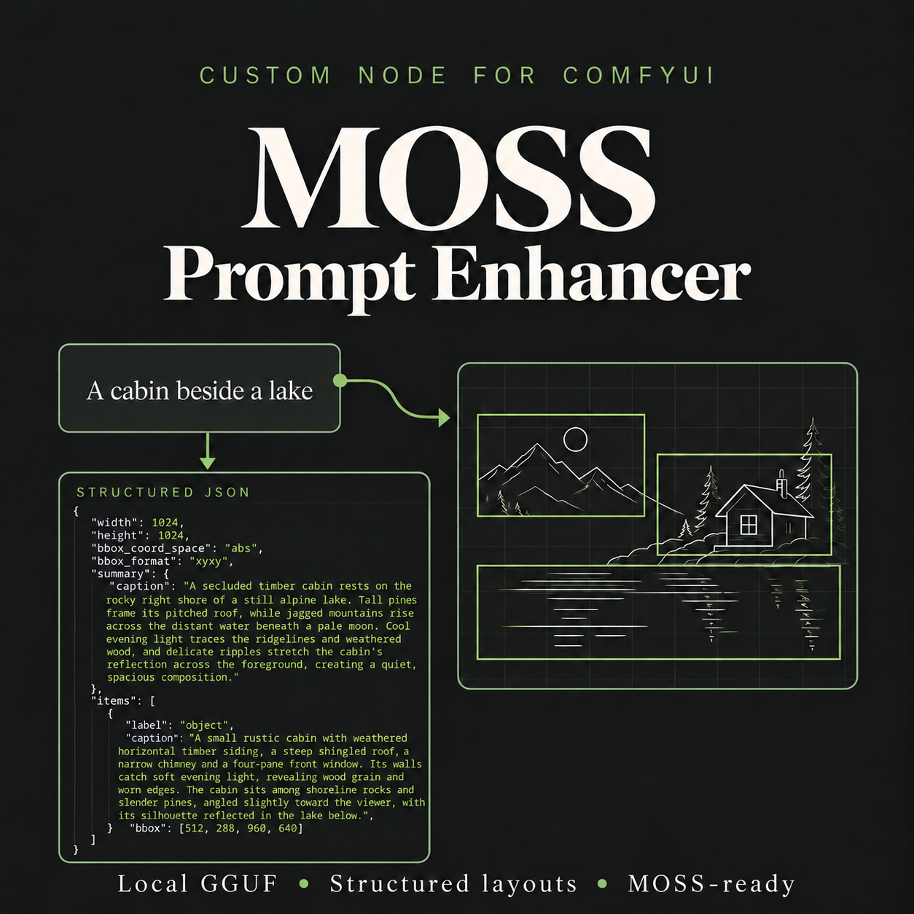

# MOSS Prompt Enhancer (GGUF)



A ComfyUI custom node that enhances ordinary image prompts into high-quality, detailed MOSS-Image prompts with proper layout and anatomical descriptions.

## Official MOSS enhancement and validation

This community node brings the prompt-enhancement workflow published by [OpenMOSS, the creators of MOSS-Image](https://github.com/OpenMOSS/MOSS-Image), into ComfyUI: enhance the description, create a caption or layout draft, then validate and compile it into a MOSS-ready prompt.

- **[Official prompt enhancement instructions (SKILL.md)](https://github.com/OpenMOSS/MOSS-Image/blob/main/skills/moss-image-prompt-enhancer/SKILL.md)** — Describes how agents should develop image descriptions, preserve the user's intent, and prepare caption or spatial-layout drafts. This node adapts those instructions for a local GGUF model.
- **[Official Python validator and compiler (compile_prompt.py)](https://github.com/OpenMOSS/MOSS-Image/blob/main/skills/moss-image-prompt-enhancer/scripts/compile_prompt.py)** — Checks the draft's fields, canvas dimensions, and bounding boxes, then converts the draft into the final MOSS prompt format. This node incorporates its compiler function.

Validation checks the generated structure and layout; it does not judge the description's creative quality or guarantee the resulting image.

## Features

- **Built-in MOSS enhancement**: Includes enhancement instructions adapted from the MOSS-Image prompt enhancer skill
- **Layout mode**: Generates structured layout JSON with bounding boxes for precise element placement
- **Caption mode**: Generates detailed natural language descriptions
- **Local GGUF inference**: Uses your local LLM models via llama.cpp (same as LLM Text Processor)
- **MOSS-ready output**: Validates and formats generated prompts using the official MOSS compiler
- **Automatic retry**: Retries invalid JSON with corrective feedback
- **GPU memory management**: Uses LLM Text Processor to release inference resources before image generation

## Installation

1. Clone or download this repository to your ComfyUI custom_nodes directory:
   ```
   <ComfyUI>/custom_nodes/ComfyUI-MOSS-Prompt-Enhancer
   ```

2. Ensure the following dependencies are installed:
   - numpy
   - Pillow
   - Python 3.10 or later

3. Install [ComfyUI LLM Text Processor by KingManiya](https://github.com/KingManiya/ComfyUI-LLM-text-processor) and follow its setup instructions. It is a required dependency for this node.

Image input requires a vision model with a matching `mmproj` file. Text-only use does not require a projector. Hardware and platform support depend on the installed LLM Text Processor. For offline use, ensure its llama.cpp backend is installed before disconnecting from the internet.

## Node Interface

### Required Inputs

| Parameter | Type | Description |
|-----------|------|-------------|
| `model` | GGUF dropdown | Local GGUF model from ComfyUI/models/LLM |
| `mmproj` | GGUF dropdown | Optional vision projector (required for image input) |
| `system_prompt` | Dropdown | Optional additional enhancement guidance |
| `prompt` | Text | Original image request to enhance |
| `max_tokens` | INT (8192) | Maximum generation tokens |
| `temperature` | FLOAT (0.3) | Sampling temperature |
| `top_p` | FLOAT (0.9) | Nucleus sampling threshold |
| `top_k` | INT (40) | Top-K sampling cutoff |
| `repeat_penalty` | FLOAT (1.05) | Repeated token penalty |
| `ctx_size` | INT (32768) | Context window size |
| `width` | INT (1024) | Canvas width in pixels |
| `height` | INT (1024) | Canvas height in pixels |
| `output_mode` | Dropdown | "Structured Layout" or "Caption" |
| `retry_invalid_json` | BOOLEAN (True) | Retry invalid JSON with error feedback |

### Optional Inputs

| Parameter | Type | Description |
|-----------|------|-------------|
| `image` | IMAGE | Optional image for vision models |
| `enable_processing` | BOOLEAN (True) | When false, passthrough original prompt |
| `extra_args` | STRING | Advanced llama.cpp parameters |

### Outputs

| Name | Type | Description |
|------|------|-------------|
| `RESPONSE` | STRING | Final compiled MOSS-Image ready prompt |
| `DRAFT_JSON` | STRING | Editable JSON draft generated by the LLM |
| `REASONING` | STRING | Extracted reasoning (if available) |
| `PERF` | STRING | llama.cpp performance metrics |
| `WIDTH` | INT | Actual canvas width |
| `HEIGHT` | INT | Actual canvas height |

## Usage

### Basic Workflow

1. Add the `MOSS Prompt Enhancer (GGUF)` node to your workflow
2. Select your local GGUF model
3. Enter your image request in the prompt field
4. Set canvas dimensions (width/height)
5. Connect the `RESPONSE` output to `MOSS Text Encode`
6. Connect the `WIDTH` and `HEIGHT` outputs to your latent generation node
7. Run the workflow

### Example

The following is an illustrative example. Actual wording and layout will vary with the selected model.

#### Original prompt

> A woman in a blue dress standing in a garden.

#### Enhanced prompt

> A woman in a flowing blue dress stands slightly left of center on a narrow gravel path in a lush garden. Her body is turned gently toward the viewer, her shoulders relaxed and her hands resting loosely at her sides. The dress falls to her ankles, with soft folds gathering around the waist and a light breeze lifting the hem. Flowering rose bushes frame the path, their pink blossoms contrasting with the blue fabric and deep green foliage. Warm afternoon sunlight filters through nearby trees, casting patches of light across her dress and soft shadows onto the gravel. An eye-level, full-length composition keeps her clearly visible while the garden recedes into a softly detailed background.

#### Structured JSON output

This is the editable `DRAFT_JSON` output before compilation. Connect the compiled `RESPONSE` output to MOSS Text Encode, and use the matching 1024 x 1024 canvas dimensions.

```json
{
  "width": 1024,
  "height": 1024,
  "bbox_coord_space": "abs",
  "bbox_format": "xyxy",
  "summary": {
    "caption": "A woman in a flowing blue dress stands slightly left of center on a narrow gravel path in a lush garden. Her body is turned gently toward the viewer, her shoulders relaxed and her hands resting loosely at her sides. The dress falls to her ankles, with soft folds gathering around the waist and a light breeze lifting the hem. Flowering rose bushes frame the path, their pink blossoms contrasting with the blue fabric and deep green foliage. Warm afternoon sunlight filters through nearby trees, casting patches of light across her dress and soft shadows onto the gravel. An eye-level, full-length composition keeps her clearly visible while the garden recedes into a softly detailed background.",
    "canvas": "single",
    "palette": [
      "soft blue",
      "rose pink",
      "deep green",
      "warm gold"
    ]
  },
  "items": [
    {
      "label": "character",
      "caption": "A woman standing with her weight resting on one leg, her torso turned slightly toward the viewer and her expression calm. Her arms hang naturally, with relaxed fingers beside her hips. She wears an ankle-length blue dress with a softly fitted waist and a flowing skirt. Sunlight catches the raised fabric folds, while cooler blue shadows describe the drape. The hem moves gently in the breeze, leaving her feet visible on the gravel.",
      "bbox": [290, 120, 610, 940]
    },
    {
      "label": "object",
      "caption": "A flowering rose bush beside the left edge of the path, with overlapping dark green leaves and clusters of open pink blossoms. Sunlit petals have delicate translucent edges, while shaded branches create depth beneath the flowers.",
      "bbox": [20, 380, 285, 920]
    },
    {
      "label": "object",
      "caption": "A taller rose bush framing the right side of the scene, with arching stems, dense green foliage and scattered pink flowers at different stages of bloom. Its uneven silhouette opens toward the central path, leaving the woman unobstructed.",
      "bbox": [690, 280, 1000, 950]
    }
  ]
}
```

## How It Works

1. The node takes your original image request
2. Uses MOSS-specific guidance to enhance it with your local GGUF model
3. Creates a detailed caption or structured layout
4. Checks the generated structure and requested canvas dimensions
5. Converts the result into the format expected by MOSS-Image
6. Returns the compiled, MOSS-Image-ready prompt

## Troubleshooting

### Node not appearing in ComfyUI
- Ensure the ComfyUI-LLM-text-processor is installed and working
- Check the ComfyUI console for import errors
- Verify Python dependencies (numpy, Pillow)

### JSON compilation errors
- Try increasing `max_tokens`
- Lower the `temperature` for more deterministic output
- Enable `retry_invalid_json` (default) for automatic correction

### Slow inference
- Use a smaller or quantized GGUF model
- Adjust `n_gpu_layers` for better GPU utilization
- Increase `timeout_seconds` if needed

## Credits

Thanks to **[KingManiya](https://github.com/KingManiya)** and the contributors to **[ComfyUI LLM Text Processor](https://github.com/KingManiya/ComfyUI-LLM-text-processor)**. This node depends on their project for local GGUF inference through llama.cpp, model and prompt discovery, optional image support, and inference process management.

Thanks to **[OpenMOSS](https://github.com/OpenMOSS/MOSS-Image)** for MOSS-Image and the official prompt enhancement instructions and validator/compiler linked above.

## License

This node uses the official MOSS-Image prompt compiler from the [OpenMOSS/MOSS-Image repository](https://github.com/OpenMOSS/MOSS-Image). See that repository for licensing details.
